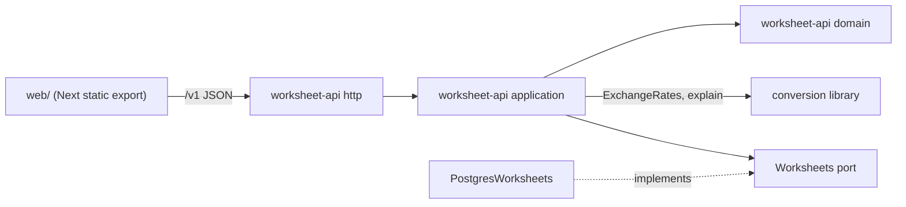

# tehlivets-currency-converter-1 · Conversion worksheet in Soft Family R6

Plan by the architect role, 2026-11-09. Every later role builds and reviews against this file.

Sources read:
- OpenDesign `currency-converter-666f/soft/`: `AGENT-BRIEF.md`, `UPLOAD-REFINEMENT.md`, `DESIGN.md`, `SCREEN-GUIDE.md`, `HANDOFF.md`, `TOKENS.json`, `theme.css`, `CHECKS.json`, `REVIEW.html`, and the nine screen files.
- The repository at `41d29df`: a Java 8 library, four JUnit tests, a placeholder README.
- Not present: `CLAUDE.md`, `.orchestrator/design.md`, `docs/adr/`. ADRs 0001 to 0004 start here.

## Archetypes

| Archetype | Fit | Where it is already modelled |
|---|---|---|
| `quantity-money` (Money) | Primary. An amount in a currency, converted by a dated directional rate. PLN is the hub. | This repository: `pl.umcs.domain.Money`, `ExchangeRate`, `CurrencyConverter`. |
| Single model, stateless calculation (`dd-heuristics-key-questions`) | The conversion answers one question from rates: "What is this amount in that currency at that moment?" | The same library. |
| Local CRUD with two invariants | The rate book of one worksheet. | New: `worksheet-api`. |

Near misses: Pricing (no price components), Accounting (no balances or ledger), Rules (no segment decisions), Graph shortest path (the route is always through PLN).

Rejected reuse:
- `~/projects/archetypes/quantity` Money: it creates only PLN amounts, has no multiply by rate, pulls Moneta and a SNAPSHOT module, and carries a CC BY-NC-SA 4.0 licence. Design reference only.
- No Java entry exists in `pipeline/reuse-registry.md`. Reused entries are in the Module seams section.

Problem classes (`dd-problemclass-problem-classes`):

| Class | Lives in |
|---|---|
| Syntactic validation: decimal strings, currency codes, moments | `worksheet-api` http layer |
| Business validation: positive rate, two different currencies | `Worksheet` aggregate and the convert use case |
| Domain logic: nearest rate, PLN route, exact product | `conversion` library only |
| Domain invariants: cap, no duplicate direction and moment | `Worksheet` aggregate |
| Persistence | `PostgresWorksheets` adapter |
| Transformation: legs to a receipt | `ConversionReceipt` read model |
| Process steering: which view comes next | web routes only |

Upload refinement R6.1: not applicable. `UPLOAD-REFINEMENT.md` names five upload fields in FamilyAssistant and Teplo. This product has no file workflow. No upload control ships.

## Domain model

Ubiquitous language: worksheet, dated rate, direction, base currency (PLN), conversion moment, leg, conversion path, missing direction, example rate.

Library `conversion` (module `conversion/`, packages `pl.umcs.domain`, `pl.umcs.api.converter`):

| Block | Kind | Rule |
|---|---|---|
| `Currency` | value object | Code string. Add a `getName()` accessor and `toString`. Equality stays. |
| `Money` | value object | `Currency` plus exact `BigDecimal`. Unchanged. |
| `ExchangeRate` | value object | Source, target, exact value, `Instant`. A rate never supplies its reverse. |
| `ExchangeRates` | domain service input | Nearest rate per direction: absolute distance, earlier wins a tie (ADR 0003). |
| `CurrencyConverter` | domain service | Direct when one side is PLN. Otherwise two legs through PLN. |
| `ConversionLeg` | new value object | Selected `ExchangeRate`, amount in, amount out. |
| `Conversion` | new value object | Source amount, target currency, requested moment, one or two legs, `result()`. |
| `NotFoundExchangeRateException` | domain error | Carries the missing source, target, and requested moment. |

Worksheet `worksheet-api` (package `pl.umcs.worksheet`):

| Block | Kind | Rule |
|---|---|---|
| `Worksheet` | aggregate root | Id, key hash, dated rates. Invariants below. |
| `WorksheetKey` | value object | 32 random bytes, base64url. Only `SHA-256(key)` is stored. Never logged. |
| `DatedRate` | entity inside `Worksheet` | `RateId`, `Direction`, `RateValue`, `RatedAt`. |
| `Direction` | value object | Source and target `Currency`. Source differs from target. |
| `RateValue` | value object | `BigDecimal` greater than zero. |
| `RatedAt` | value object | `Instant` between 1900-01-01 and 2100-12-31 UTC. |
| `ConversionReceipt` | read model | Amount, result, base currency, requested moment, legs. All decimals as plain strings. |

Invariants of `Worksheet`:
1. At most 500 dated rates (`worksheet_full`).
2. One dated rate per direction and moment (`rate_exists`).
3. A rate belongs to exactly one worksheet. Removal of an unknown rate id is `rate_not_found`.

Events: none are published. `RateKept` and `RateRemoved` are past-tense names for the use cases only. No consumer needs them.

Value rules at the trust boundary:
- Decimal strings match `^[0-9]{1,15}(\.[0-9]{1,12})?$` and are greater than zero. A JSON number is refused.
- Currency codes pass `java.util.Currency.getInstance`.
- Moments are ISO-8601 with an offset. The web client sends the browser local time with its offset.
- Request bodies are at most 4 KB.
- The result is exact. Display uses `stripTrailingZeros().toPlainString()` and never rounds.

## Architecture drivers

| Driver (charter) | How this item answers | Size |
|---|---|---|
| Scale: 100,000 users, never block 1,000,000 | Stateless API process. Rates in Postgres. Convert reads at most two directions through an index. No in-memory cache. | 500 rates per worksheet. Target p95 under 150 ms server time for convert. Measure in `smoke-passed`. |
| Scale: externalised state | Rates and worksheets in Postgres. The client holds only its key. | Any instance can restart. |
| Clients: versioned API, `docs/api.md`, authorized per route | `/v1` routes. Bearer worksheet key on every worksheet route. Error codes are stable and carry no prose. | Five worksheet routes, one health route. |
| Clients: domain logic behind the API | Selection, routing, and multiplication stay in the library behind `/v1`. The web client never computes. | — |
| Cost: idle near zero | One small container. Neon free tier. Static export served by the same process. | No subscriptions. |
| Pragmatism: reuse first | Library kept. yana design system ported. Registry ideas ported with their tests. | — |
| Quality: accessibility | Keyboard path, visible focus, labels, errors beside the field, reduced motion, 44 px targets. | Zero axe violations per view. |

Trades away:
- Cross-device rates without accounts (ADR 0002).
- One language. Java for the domain and API, TypeScript for the client (ADR 0001).
- Strict compatibility for future-dated rates in the library (ADR 0003).

## ADR context

| ADR | Status | Subject |
|---|---|---|
| [0001](../../docs/adr/0001-a-java-api-serves-the-worksheet-and-its-web-client.md) | new | Java API wraps the library. One container serves `/v1` and the web export. |
| [0002](../../docs/adr/0002-rates-live-in-a-server-worksheet-opened-by-a-key.md) | new | Server worksheet in Neon Postgres. A worksheet key opens it. |
| [0003](../../docs/adr/0003-the-nearest-rate-is-nearest-in-both-directions-of-time.md) | new | Absolute nearest-date rule, tie rule, `explain` with legs. |
| [0004](../../docs/adr/0004-the-web-client-ports-the-yana-design-system-in-soft-r6-materials.md) | new | yana design system ported in Soft R6 materials. No upload control. |
| Portfolio ADR-037 | touched | Compact STE for every document. |

## Module seams

Dependency rules, each pinned by an ArchUnit test:
- `conversion` imports nothing outside the JDK and Lombok.
- `pl.umcs.worksheet.domain` imports no Javalin, Jackson, or `java.sql`.
- Only `pl.umcs.worksheet.application.ConvertOnWorksheet` imports the library converter. It is the anti-corruption layer from `DatedRate` to `ExchangeRate`.
- The web client calls the API only through `web/src/lib/worksheet-api.ts`.

API contract `/v1` (write it in `docs/api.md`):

| Route | Auth | Success | Refusals |
|---|---|---|---|
| `POST /v1/worksheets` | none | 201 `{worksheetKey}` | 429 at the edge |
| `GET /v1/worksheet/rates` | key | 200 `{rates:[{id,from,to,rate,ratedAt}], limit:500}` | 401 |
| `POST /v1/worksheet/rates` `{from,to,rate,ratedAt}` | key | 201 rate | 400 field code, 401, 409 `rate_exists`, 422 `worksheet_full` |
| `DELETE /v1/worksheet/rates/{id}` | key | 204 | 401, 404 `rate_not_found` |
| `POST /v1/worksheet/conversions` `{amount,from,to,at}` | key | 200 receipt `{amount,result,base,at,legs:[{from,to,rate,ratedAt,amountIn,amountOut}]}` | 400 field code, 401, 422 `rate_missing` `{missing:{from,to},at}` |
| `GET /v1/health` | none | 200 `{status, revision}` | — |

Refusal shape: `{"error":{"code":"invalid_amount","field":"amount"}}`. Field codes: `invalid_amount`, `invalid_rate`, `invalid_currency`, `same_currency`, `invalid_moment`.

Persistence (Flyway `V1__worksheets.sql`):
- `worksheets(id uuid pk, key_hash bytea unique not null, created_at timestamptz)`.
- `dated_rates(id uuid pk, worksheet_id uuid fk on delete cascade, source_currency char(3), target_currency char(3), rate numeric not null, rated_at timestamptz, unique(worksheet_id, source_currency, target_currency, rated_at))`.
- Index `(worksheet_id, source_currency, target_currency)`.
- Keep a rate: `SELECT ... FOR UPDATE` on the worksheet row, count, insert, in one transaction.

View map (nine design screens to routes and roles):

| Design screen | Route | Role | Data |
|---|---|---|---|
| `index.html` Currency Converter | `/` | visitor, holder | `GET rates` fills From and To with PLN plus currencies in the worksheet |
| `loading.html` Finding your rate | `/result` while the convert request is in flight | holder | real pending request, skeleton shaped like the receipt |
| `result.html` Conversion result | `/result?amount&from&to&at` | holder | `POST conversions`. Path nodes and one row per leg. |
| `missing-rate.html` A rate is missing | `/result` on `rate_missing` | holder | Links to `/rates/new?from&to&at` prefilled with the missing direction |
| `error.html` Check your amount | `/` with field errors | visitor, holder | Client check, then server field code beside the field |
| `rates.html` Your rates | `/rates` | holder | `GET rates`, remove control per row |
| `empty.html` No rates yet | `/rates`, and `/result`, with no key or zero rates | visitor | No request without a key |
| `rate-add.html` Add a dated rate | `/rates/new` | visitor, holder | First keep calls `POST /v1/worksheets`, then `POST rates` |
| `method.html` How conversion works | `/how-it-works` | anyone | Static copy that states ADR 0003 rules |

Roles: `visitor` has no worksheet key. `holder` has a key in this browser. No other role exists.
Shell: header island with brand, Convert, Rates, How it works, and a menu toggle under 768 px. The header CTA goes to `/`. Footer as designed.
Copy: use the screen copy. Show "Example rates. This result is not a market quote." on result and rates.

Reused, with tests:
- yana-wishlist design system and guards (ADR 0004).
- yana `fits-the-screen.spec.ts`, `a-control-answers-to-a-thumb.spec.ts`, `fields-do-not-zoom-the-page.spec.ts`.
- yana `a-module-keeps-to-itself` idea as the ArchUnit tests above.
- guitarhaven ADR 0078 idea: the client maps a refusal code to its own copy and never renders server text.
- yana `the-served-build-is-this-build` idea: `GET /v1/health` reports the revision that the e2e setup checks.

Build order (one pull request, four reviewable slices):
1. Build: Maven aggregator, wrapper, Java 21, Lombok 1.18.34+, JUnit 5.10, Surefire. `git mv src conversion/src`.
2. Library: ADR 0003 changes and tests.
3. API: domain, use cases, Postgres adapter, routes, `docs/api.md`, `docker compose` with Postgres for local runs.
4. Web: port, nine views, e2e, `docs/design-coverage.md`, screenshots at 1440, 768, and 390 px.

Delivery: an OCI image with the API and the web export. Config by environment: `DATABASE_URL`, `REVISION`. Request `DATABASE_URL` with `orchestrator credential request --provider neon`. The delivery process chooses the host and the edge rate-limit rule.

## Test scenarios

Library (`conversion`, JUnit). The four existing tests stay unchanged.
- `should_select_the_past_rate_when_it_is_nearer_than_a_future_rate`
- `should_select_the_future_rate_when_it_is_nearer_than_a_past_rate`
- `should_prefer_the_earlier_rate_when_two_rates_are_equally_near`
- `should_select_a_rate_centuries_away_without_overflow`
- `should_explain_a_direct_conversion_as_one_leg`
- `should_explain_a_cross_conversion_as_two_legs_through_pln`
- `should_keep_the_exact_decimal_product_across_two_legs`
- `should_not_use_the_reverse_direction_of_a_rate`
- `should_name_the_missing_direction_and_moment`

Worksheet domain (JUnit, no I/O):
- `refuses_a_rate_beyond_five_hundred`
- `refuses_a_second_rate_for_the_same_direction_and_moment`
- `refuses_a_rate_from_a_currency_to_itself`
- `refuses_a_rate_that_is_not_greater_than_zero`
- `removing_an_unknown_rate_is_refused`

API (JUnit against real Postgres from `docker compose`, no mocks):
- `starting_a_worksheet_returns_its_key_once`
- `a_worksheet_route_without_a_key_is_refused`
- `a_worksheet_cannot_read_or_remove_the_rates_of_another`
- `a_kept_rate_is_listed_with_its_exact_value`
- `converting_through_pln_returns_both_legs_and_their_selected_rates`
- `converting_with_a_missing_direction_names_that_direction`
- `an_amount_with_a_comma_is_refused_beside_the_amount_field`
- `an_amount_sent_as_a_json_number_is_refused`
- `converting_a_currency_to_itself_is_refused`
- `two_concurrent_rates_cannot_pass_the_limit`
- `a_removed_rate_no_longer_takes_part_in_a_conversion`
- `health_reports_the_running_revision`
- `the_conversion_library_depends_on_no_framework`
- `the_worksheet_domain_imports_no_http_or_sql`

Web unit (Vitest), plus the ported source guards:
- `a refusal code becomes field copy and never server text`
- `a visitor without a key sees how to begin`

E2E (Playwright, every spec at 1440, 768, and 390 px):
- `a visitor keeps a first rate and converts directly`
- `a cross conversion shows two steps and their dated rates`
- `a missing direction offers to add exactly that rate`
- `an invalid amount is explained beside the field`
- `rates without any rate show how to begin`
- `a removed rate leaves the list`
- `the result shows its skeleton while the request is in flight` (the spec delays the real route, no timer in the app)
- `every route fits the screen without sideways scroll`
- `a control answers to a thumb`
- `every action is reachable by keyboard with visible focus`
- `reduced motion stops movement`
- `every route has no axe violations`

Evidence: `docs/design-coverage.md` lists each of the nine screens with route, states covered, and screenshot paths. Screenshots go to the factory evidence directory for this item.

## Not doing

- No upload control. This product has no file workflow (R6.1 applies to FamilyAssistant and Teplo).
- No accounts, sign-in, worksheet sharing, export, or expiry.
- No rate provider, live quote, or market data. No sample rates in production.
- No same-currency result. The API refuses it. The library behaviour for it stays.
- No font changes beyond the approved two families.
- No edit-in-place for a rate. Remove it and keep a new one.
- No claim of an existing public deployment. The host comes from the delivery process.
- No native client. The `/v1` contract prepares for one.
- No `soft.js` or `soft.css` in the product. No `DesignSync` or OpenDesign writes.
- No changes to other OpenDesign projects or their archives.
