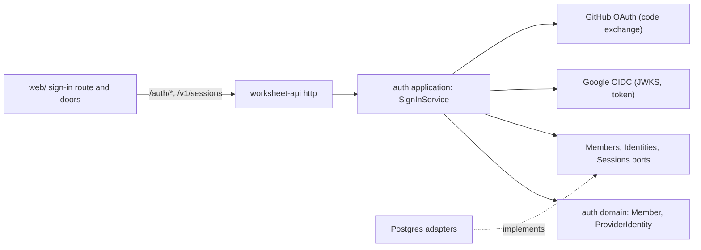

# tehlivets-currency-converter-3 · People sign in through Google or GitHub

Plan by the architect role, 2026-11-19. Every later role builds and reviews against this file.

## Archetypes

| Archetype | Fit | Where it is already modelled |
|---|---|---|
| Party (identity) | Primary. A member is a stable identity with roles and provider links. | Portfolio: `archetype-party-core`. New here: `worksheet-api` auth package. |
| Rules | The link rule: a provider identity joins a member only through a verified email. | New: `SignInService`. |
| Single model, stateless calculation | Sign-in verifies an assertion and issues a session. No workflow state beyond the state cookie. | New. |

Rejected reuse:
- `conversion` library: unchanged. It owns rates, not identity.
- gtd-saas password auth (ADR-003): superseded by ADR-050. Passwords remain only for the dev test door.
- yana-wishlist session cookie: ported the `__Host-` name idea, adapted to Java.

Problem classes (`dd-problemclass-problem-classes`):

| Class | Lives in |
|---|---|
| Syntactic validation: JWT shape, nonce format, next path | `worksheet-api` http layer |
| Business validation: verified email, unique provider identity, aud match | `SignInService` |
| Domain logic: link or create member by (provider, subject) | `worksheet-api` domain |
| Domain invariants: unique (provider, subject), one member per identity | database constraint |
| Persistence | `PostgresMembers`, `PostgresProviderIdentities`, `PostgresSessions` |
| Transformation: Google claims to `Assertion` | http adapter |
| Process steering: redirect and cookie handling | web redirect adapter |

## Domain model

Ubiquitous language: member, provider identity, assertion, session, state cookie, dev test door.

`worksheet-api` (package `pl.umcs.auth`):

| Block | Kind | Rule |
|---|---|---|
| `Member` | aggregate root | Id, verified email, password hash (nullable, dev only), created at. |
| `ProviderIdentity` | entity inside `Member` | Provider (google or github), subject, verified email at link time, linked at. |
| `Assertion` | sealed value object | GoogleAssertion, GitHubAssertion, or TestPasswordAssertion. |
| `Session` | value object | Id, member id, issued at, expires at. |
| `StateCookie` | value object | State, nonce, PKCE verifier, next path, issued at. |

Invariants:
1. `(provider, subject)` is unique across all members.
2. A member has at most one identity per provider.
3. A provider identity links to a member only when the provider marks the email verified.
4. Never store provider tokens.
5. A password identity exists only in dev.
6. The next path starts with one slash and never two slashes or a slash and a backslash.

Events: none published. Sign-in returns a session. No downstream consumer needs an event.

Value rules at the trust boundary:
- Google ID tokens are verified against the Google JWKS. Check iss, aud, exp, and nonce.
- The Google iss is exactly `https://accounts.google.com` or `accounts.google.com`.
- A token taken from the Google token endpoint over TLS can be read without its signature.
- A client-sent token is verified against the Google JWKS with aud set to this environment's client IDs.
- GitHub authorization codes are exchanged on the server only. Never accept a GitHub access token from a client.
- State, nonce, and verifier live in a host-only cookie marked HttpOnly, Secure, SameSite=Lax, for ten minutes, read once.
- `POST /v1/sessions` uses a short-lived server-issued nonce read once.
- Issue a fresh session id in a `__Host-` cookie marked HttpOnly and Secure.
- Identify members by provider and subject. Never use email or login.
- Cache the Google JWKS per isolate and honour Cache-Control.

## Architecture drivers

| Driver (charter) | How this item answers | Size |
|---|---|---|
| Scale: 100,000 users, never block 1,000,000 | Stateless sign-in. One unique-index read per lookup. JWKS cached per isolate. No shared broker. | 100,000 members. Path to 1,000,000. |
| Scale: externalised state | Members, identities, and sessions in Postgres. | Any instance can restart. |
| Clients: versioned API, docs/api.md, authorized per route | `POST /v1/sessions` added. Web redirect adapter added. Domain logic behind the API. | One new route plus auth routes. |
| Cost: idle near zero | Google sign-in is free. No new subscription. | No extra infra. |
| Pragmatism: reuse first | Port proven OAuth, state cookie, and JWKS code from the portfolio. | Reuse list in Module seams. |

Trades away:
- Password sign-in in production.
- A shared identity broker.
- Magic links for this product (no kept door).

## ADR context

| ADR | Status | Subject |
|---|---|---|
| [000](../../docs/adr/000-charter-drivers.md) | new | Charter drivers for this product. |
| [0001](../../docs/adr/0001-a-java-api-serves-the-worksheet-and-its-web-client.md) | touched | Auth routes live in the same container. |
| [0002](../../docs/adr/0002-rates-live-in-a-server-worksheet-opened-by-a-key.md) | touched | Worksheets stay keyed. |
| [0005](../../docs/adr/0005-people-sign-in-through-google-or-github.md) | new | People sign in through Google only. |
| Portfolio ADR-050 | cited | The standard this follows. |
| Portfolio ADR-019 | cited | Dev test identity. |

## Module seams

Dependency rules:
- `conversion` imports nothing outside the JDK and Lombok. Unchanged.
- `pl.umcs.auth.domain` imports no Javalin, Jackson, or `java.sql`.
- Only `pl.umcs.auth.application.SignInService` calls Google and GitHub adapters.
- The web client calls the API only through `web/src/lib/worksheet-api.ts` and the auth routes.
- Reuse from `pipeline/reuse-registry.md`: guitarhaven OAuth route pair, skill-catalog GitHub numeric id, quiz-show state cookie, quiz-show token-endpoint read, refd-pipeline client-token JWKS verification.

New database tables:
- `members(id uuid pk, verified_email text not null, password_hash text, created_at timestamptz)`.
- `provider_identities(provider text, subject text, member_id uuid fk, verified_email text, linked_at timestamptz, primary key (provider, subject))`.
- `sessions(id uuid pk, member_id uuid fk, issued_at timestamptz, expires_at timestamptz)`.

## Test scenarios

Domain (JUnit, no I/O):
- `a_google_assertion_creates_a_member_on_first_sign_in`
- `a_returning_google_assertion_returns_the_same_member`
- `a_google_token_minted_for_another_client_is_refused`
- `an_unverified_github_address_never_joins_an_existing_member`
- `a_member_stays_the_same_after_an_email_change_at_the_provider`
- `a_github_member_keeps_access_after_a_login_rename`
- `an_existing_member_who_first_signs_in_with_google_keeps_the_account`

HTTP (JUnit against real Postgres):
- `state_mismatch_is_refused`
- `a_sign_in_returned_to_a_different_browser_is_refused`
- `the_next_path_must_start_with_one_slash`
- `post_v1_sessions_uses_a_server_issued_nonce_once`
- `a_fresh_session_id_is_issued_in_a_host_cookie`

Web (Vitest / Playwright):
- `production_serves_no_password_form`
- `the_dev_test_door_signs_in_only_where_the_dev_flag_is_set`

## Not doing

- No GitHub door. The audience is `everyone`.
- No kept door. No magic link, no Telegram link, no password page in production.
- No worksheet ownership by member. Worksheets stay keyed.
- No Google One Tap, FedCM, or rendered button iframe.
- No account settings or linked-accounts screen.
- No native client yet. The `/v1` contract prepares for one.
- No multi-region or read replicas.
